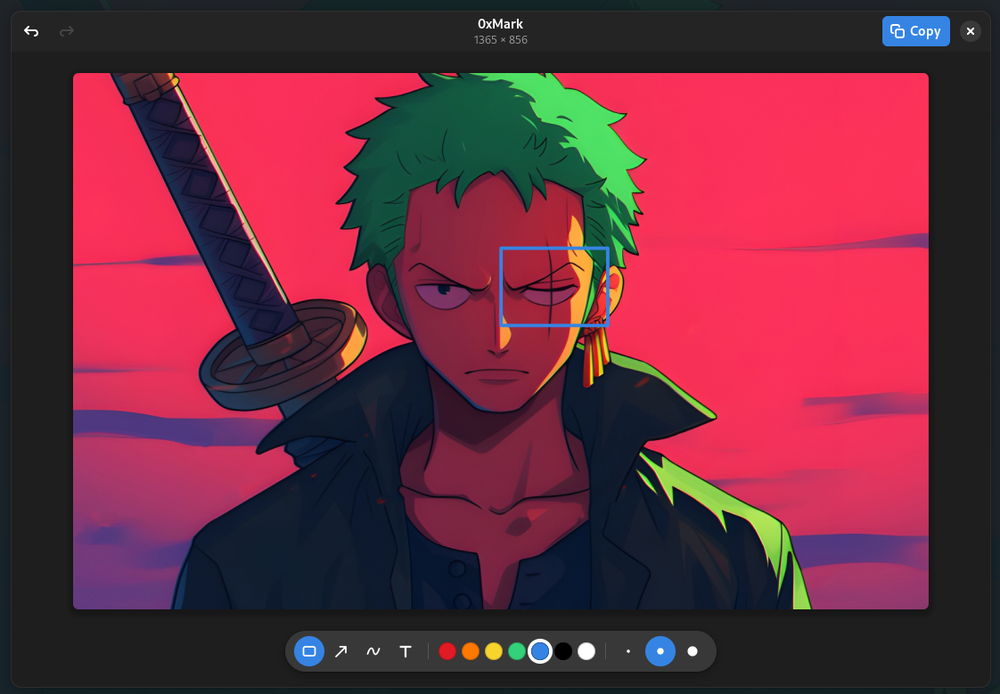

# 0xMark

A tiny GNOME app for marking up images on the clipboard.

Copy an image, open 0xMark, draw a box or an arrow, press `Enter`. The annotated image is back on
the clipboard, ready to paste into chat, email, an issue tracker or a document.



## Features

- Loads the clipboard image automatically when the window opens.
- Rectangles, circles and ellipses, arrows, freehand pen and text labels.
- Seven colours and three stroke sizes.
- Undo and redo.
- Exports at the original resolution, whatever the zoom level in the window.
- Follows the GNOME light or dark style.

## Install

```sh
curl -fsSL https://raw.githubusercontent.com/abidibo/0xMark/main/install.sh | bash
```

The script:

1. installs GTK, libadwaita and `wl-clipboard` with `apt`, `dnf` or `pacman` if they are missing.
   It asks for your password only then. A GNOME desktop usually has all of them except
   `wl-clipboard`
2. downloads the prebuilt binary from the [latest release](https://github.com/abidibo/0xMark/releases/latest)
   for your processor, x86_64 or ARM64, and checks its SHA-256 checksum
3. installs it to `~/.local/bin/0xmark` and adds 0xMark to the GNOME app grid
4. binds **Super+Shift+A** to open 0xMark, unless that shortcut is already taken

It takes a few seconds and needs no Rust.

If no binary fits your system, the script builds 0xMark from source instead. It installs the
build packages and, if your Rust is missing or older than 1.85, installs Rust with
[rustup](https://rustup.rs). If you already use rustup, it leaves your default toolchain alone.
The build takes a minute or two.

Run it again to update. Pick another key with `OXMARK_HOTKEY`, or pass an empty value to skip
the shortcut:

```sh
curl -fsSL https://raw.githubusercontent.com/abidibo/0xMark/main/install.sh | OXMARK_HOTKEY='<Super><Shift>m' bash
```

You can change the shortcut later in **Settings > Keyboard > View and Customize Shortcuts >
Custom Shortcuts**.

Other options:

| Variable | Effect |
|---|---|
| `OXMARK_HOTKEY='<Super><Shift>m'` | Bind another shortcut. Empty skips the shortcut. |
| `OXMARK_VERSION=1.1.0` | Install a specific release instead of the latest. |
| `OXMARK_FROM_SOURCE=1` | Build from source even when a binary is available. |

From a clone, `./install.sh` always builds and installs that checkout.

### Requirements

- Linux with a **GNOME Wayland** session. X11 sessions are not supported.
- GTK 4.14 or newer and libadwaita 1.5 or newer. Ubuntu 24.04, Pop!\_OS 24.04 and Fedora 40 or
  newer have these. Ubuntu 22.04 does not.
- `wl-clipboard`, which provides the `wl-copy` command.
- Rust 1.85 or newer, only to build from source.

The prebuilt binaries are built on Ubuntu 24.04, so they run on it and on newer distributions.
The installer takes care of everything except the session and the distribution version.

### Manual install

If you'd rather run each step yourself, install the build dependencies and Rust. On Ubuntu,
Pop!\_OS or Debian:

```sh
sudo apt install build-essential pkg-config libgtk-4-dev libadwaita-1-dev wl-clipboard curl && curl --proto '=https' --tlsv1.2 -sSf https://sh.rustup.rs | sh -s -- -y && . ~/.cargo/env
```

On Fedora, `sudo dnf install gcc pkgconf-pkg-config gtk4-devel libadwaita-devel wl-clipboard`. On
Arch, `sudo pacman -S base-devel gtk4 libadwaita wl-clipboard`. Then install Rust with the
`curl` command above.

Build and install:

```sh
git clone https://github.com/abidibo/0xMark.git
cd 0xMark
cargo build --release
install -Dm755 target/release/0xmark ~/.local/bin/0xmark
install -Dm644 data/icons/dev.abidibo.OxMark.svg \
  ~/.local/share/icons/hicolor/scalable/apps/dev.abidibo.OxMark.svg
touch ~/.local/share/icons/hicolor
mkdir -p ~/.local/share/applications
sed "s|^Exec=0xmark$|Exec=$HOME/.local/bin/0xmark|" data/dev.abidibo.OxMark.desktop \
  > ~/.local/share/applications/dev.abidibo.OxMark.desktop
```

The `sed` line writes the full path of the binary into the desktop entry. Some GNOME sessions do
not have `~/.local/bin` on their `PATH`, and GNOME silently hides desktop entries whose program it
cannot find. The `touch` line tells running apps, such as GNOME Shell or a launcher, to
reload icons.

Then bind a key: open **Settings > Keyboard > View and Customize Shortcuts > Custom Shortcuts**
and add a shortcut named `0xMark`. For the command, use the full path, which
`echo ~/.local/bin/0xmark` prints. Pick a combination such as `Super+Shift+A`.

## Usage

1. Copy an image. For a screenshot, press `Print`, select an area and confirm. GNOME puts the
   screenshot on the clipboard. Copying an image from a browser or an image viewer works too.
2. Open 0xMark with your shortcut, `Super+Shift+A` by default. The image appears right away.
3. Pick a tool, a colour and a size in the toolbar at the bottom, then drag on the image.
   Hold `Shift` while dragging a circle to keep it round. For text, click where the label should
   go, type it and press `Enter`.
4. Press `Enter` or click **Copy**. 0xMark closes and the annotated PNG is on the clipboard.
5. Paste it wherever you need it.

Press `Esc` to close without touching the clipboard.

### Shortcuts

| Key                | Action                                                   |
|--------------------|----------------------------------------------------------|
| `R`                | Rectangle                                                |
| `C`                | Circle, hold `Shift` while dragging for a perfect circle |
| `A`                | Arrow                                                    |
| `P`                | Freehand pen                                             |
| `T`                | Text, then click to place                                |
| `1` `2` `3`        | Thin, medium or thick stroke                             |
| `Ctrl+Z`           | Undo                                                     |
| `Ctrl+Shift+Z`     | Redo, `Ctrl+Y` also works                                |
| `Ctrl+V`           | Load the clipboard image again                           |
| `Enter` / `Ctrl+C` | Copy the result and close                                |
| `Esc`              | Close without copying                                    |

## Troubleshooting

**0xMark is missing from the app grid or your launcher.** The desktop entry probably still says
`Exec=0xmark` and your session cannot find it. Run the installer again, or repeat the `sed` step
from the manual install.

**"No image in clipboard".** The clipboard holds text or nothing. Copy an image and press
`Ctrl+V` in the window.

**"cannot run wl-copy".** Install `wl-clipboard`, or run the installer again.

**The installer says GTK 4.14 or newer is required.** Your distribution is too old. Ubuntu 22.04
ships GTK 4.6; upgrade to 24.04 or newer.

**The pasted image is empty or the paste fails.** You are probably in an X11 session. Check with
`echo $XDG_SESSION_TYPE`. It must print `wayland`.

## Uninstall

```sh
curl -fsSL https://raw.githubusercontent.com/abidibo/0xMark/main/install.sh | bash -s -- --uninstall
```

Or `./install.sh --uninstall` from a clone. This removes the binary, the app grid entry, the icon
and the shortcut. System packages and Rust stay installed.

## Releasing

Pushing a tag builds the binaries and publishes the release through GitHub Actions
(`.github/workflows/release.yml`):

1. Set the new `version` in `Cargo.toml`, run `cargo build` to update `Cargo.lock`, and commit.
2. Tag and push, using the same version with no `v` prefix:

   ```sh
   git tag 1.2.0
   git push origin main 1.2.0
   ```

The workflow stops if the tag and `Cargo.toml` disagree. The installer picks up the new release
right away.

## How it works

0xMark is a single Rust file using GTK 4 and libadwaita. It reads the clipboard through GTK and
draws annotations with Cairo. Annotations are kept in image coordinates, so the preview can be
scaled freely while the export stays at full resolution.

On Wayland, clipboard content belongs to the app that copied it and disappears when that app
quits. 0xMark therefore hands the final PNG to `wl-copy`, which keeps serving it in the background
after 0xMark has closed.

## License

MIT. See [LICENSE](LICENSE).
